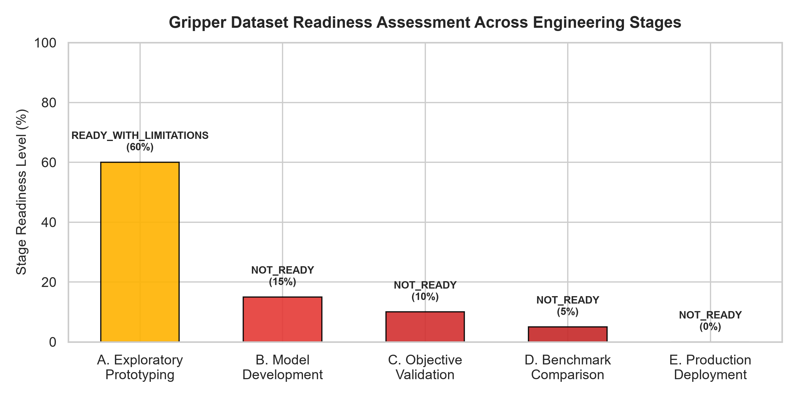
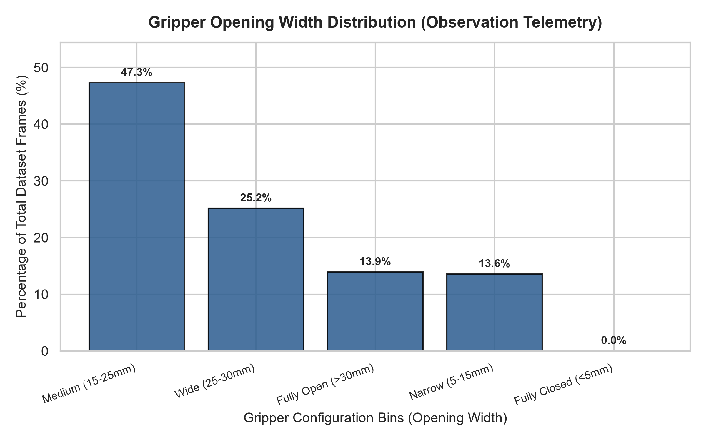
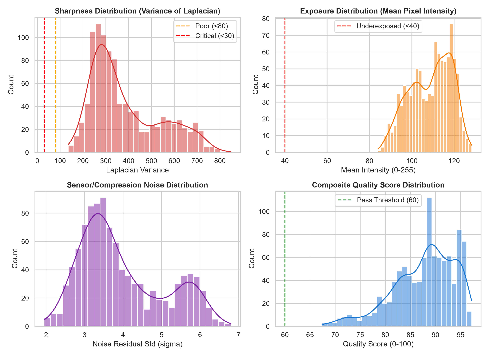

# Computer Vision – Gripper Pose Estimation & Dataset Quality Assessment

[](https://www.python.org/downloads/)
[](https://opensource.org/licenses/MIT)
[](https://streamlit.io/)
[](#audit-verdict--key-findings)

An engineering-grade quality-control audit and diagnostics framework evaluating dataset suitability for 3D gripper pose estimation and moving-flap fiducial marker tracking.

---

## 📌 Executive Summary & Audit Verdict

> **FINAL AUDIT VERDICT: ⛔ NOT READY (CRITICAL BLOCKERS CONFIRMED)**  
> The audited dataset (`mv-umi-markers-placement`) **cannot** reliably support the development, validation, or benchmarking of a fiducial-marker-based gripper pose estimation and opening-state measurement system.

### Core Findings & Blockers:
1. **Absence of Fiducial Markers on Gripper Flaps (P0 Blocker):** The physical flaps visible in the wrist camera (`camera0_rgb`) are plain, untextured red 3D-printed plastic. Multi-dictionary scanning across 10 ArUco and AprilTag families detected **0 markers** on the flaps.
2. **Task Scope & Semantic Ambiguity (P0 Blocker):** The dataset task name *"Markers Placement"* refers to manipulating **physical dry-erase whiteboard pens** into a holder, **not** fiducial markers on gripper flaps.
3. **Complete Absence of 2D/3D Vision Annotations (P0 Blocker):** Zero bounding boxes, keypoints, or marker corner coordinates exist anywhere in the dataset.
4. **Severe Resolution Constraints (P1 Blocker):** Videos are downscaled to **224 × 224 pixels** with H.264 compression artifacts. Prospective markers would occupy fewer than 12–15 pixels, precluding sub-millimeter corner localization.
5. **Missing Camera Calibration (P0 Blocker):** No camera intrinsic matrices ($K$), lens distortion coefficients, or camera-to-gripper extrinsic transforms are provided.
6. **Data Integrity & Chunk Corruption (P0 Defect):** Secondary chunk `file-001.parquet` contains conflicting, corrupted duplicate episodes (episodes 30–59) with mismatched lengths and timestamps.

---

## 📊 Diagnostic Visual Evidence

### 1. Lifecycle Stage Readiness Matrix


### 2. Gripper Opening Width Distribution (Telemetry)


### 3. Photometric & Computer Vision Quality Metrics


---

## 📁 Repository Layout

```
.
├── .gitignore                         # Excludes large raw videos (>100MB) and temp files
├── README.md                          # Main repository documentation
│
├── .vscode/                           # One-click VS Code launch and debug configurations
│   ├── launch.json                    # F5 debug configs (Pipeline, Dashboard, Tests)
│   └── settings.json                  # Python interpreter and test discovery
│
├── gripper_dataset_audit/             # Core audit suite
│   ├── config/
│   │   └── audit_config.yaml          # Configurable thresholds, sampling rates, and ROIs
│   ├── src/
│   │   ├── dataset_discovery.py       # Inventory, LeRobot schema, chunk parsing
│   │   ├── file_integrity.py          # Decode validation, stream integrity, duplicate chunks
│   │   ├── image_quality.py           # Sharpness (Laplacian, Tenengrad), exposure, contrast, noise
│   │   ├── marker_visibility.py       # Multi-dict ArUco/AprilTag scan, flap ROI segmentation
│   │   ├── annotation_audit.py        # Vision annotation audit, 7-DoF state telemetry validation
│   │   ├── geometric_analysis.py      # Kinematic velocity bounds, trajectory continuity
│   │   ├── duplicate_detection.py     # SHA-256 exact & pHash perceptual duplicate grouping
│   │   ├── sequence_analysis.py       # 30 FPS timing, stream sync, chunk split timestamp reset
│   │   ├── image_diversity.py         # PCA embeddings, clustering, repetitiveness metrics
│   │   ├── distribution_analysis.py   # Gripper opening bins, episode lengths, spatial workspace
│   │   ├── outlier_detection.py       # Statistical IQR and Isolation Forest anomaly screening
│   │   ├── risk_analysis.py           # Formal engineering risk register and P0-P3 action plan
│   │   ├── visualization.py           # Diagnostic figures, overlay generation, readiness plots
│   │   ├── report_generator.py        # Executive Summary, Technical Audit, PDF report generator
│   │   ├── audit_pipeline.py          # Unified CLI orchestrator
│   │   └── dashboard.py               # Interactive Streamlit inspection dashboard
│   ├── notebooks/
│   │   └── dataset_exploration.ipynb  # Interactive Jupyter exploration notebook
│   ├── tests/
│   │   └── test_audit_suite.py        # Unit test suite (100% pass)
│   └── requirements.txt               # Python package dependencies
│
└── outputs/                           # Auditing artifacts and reports
    ├── reports/
    │   ├── EXECUTIVE_SUMMARY.md       # High-level management briefing
    │   ├── TECHNICAL_DATASET_AUDIT.md # In-depth technical audit document
    │   ├── Dataset_Quality_Audit.pdf  # 4-page publication-grade PDF report
    │   └── audit_summary.json         # Machine-readable JSON summary
    ├── figures/                       # High-resolution diagnostic charts
    ├── tables/                        # CSV audit reports (risk register, metrics, outliers)
    └── visual_inspections/            # Physical flap ROI segmentation overlays
```

---

## 🚀 Quickstart & Execution

### 1. Installation
Clone the repository and install dependencies:
```bash
git clone https://github.com/<your-username>/<repo-name>.git
cd <repo-name>
pip install -r gripper_dataset_audit/requirements.txt
```

### 2. Run the Full Audit Pipeline
```bash
python gripper_dataset_audit/src/audit_pipeline.py \
    --dataset mv-umi-markers-placement \
    --output outputs \
    --config gripper_dataset_audit/config/audit_config.yaml
```

### 3. Launch Interactive Streamlit Dashboard
```bash
streamlit run gripper_dataset_audit/src/dashboard.py
```

### 4. Run Unit Test Suite
```bash
python -m unittest gripper_dataset_audit/tests/test_audit_suite.py
```

---

## 📑 Generated Reports & Documentation

- [Executive Summary](outputs/reports/EXECUTIVE_SUMMARY.md)
- [Technical Audit Document](outputs/reports/TECHNICAL_DATASET_AUDIT.md)
- [PDF Quality Audit Report](outputs/reports/Dataset_Quality_Audit.pdf)
- [Formal Risk Register CSV](outputs/tables/risk_register.csv)
- [Prioritized Recommendations CSV](outputs/tables/recommendations.csv)

---

## ⚖️ License

MIT License. See [LICENSE](LICENSE) for details.
